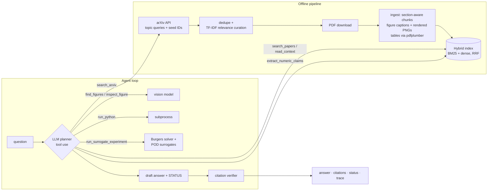

# Architecture and design choices

## 1. Collection (automated)
- Six boolean arXiv queries plus 16 verified seed IDs. The seeds guarantee that the gold papers of
  the evaluation set are present. The search adds breadth.
- **Curation, not just retrieval:** candidates are de-duplicated (arXiv ID + normalised title) and
  scored by TF-IDF cosine against a topic description. Keyword search returns off-topic hits (e.g.
  "graph neural network AND mesh" pulls in graphics papers), and this step filters them without manual review.
- Polite rate limiting (3 s), retries, and resumable downloads. Failures are logged and the paper is kept as abstract-only.

## 2. Ingestion and multimodality
- **Section-aware chunking** (~220 words, 40-word overlap, sentence boundaries). The section name
  is prepended to the chunk ("[Results] …") and the paper title is prepended at indexing time. This
  is cheap contextual chunking that helps both lexical and dense retrieval.
- **References are dropped.** Bibliographies match almost every query lexically but contain no evidence.
- **Figures:** CFD figures are mostly vector graphics, so extracting embedded bitmaps misses them.
  We locate "Figure N:" captions and *render* the page region above the caption to PNG. The caption is
  indexed as a `figure` chunk pointing to the image. The agent finds figures by text and then *looks
  at them* with a vision model (`inspect_figure`). This is a two-stage design: text retrieval is cheap and precise,
  and vision is called only on demand.
- **Tables:** caption plus pdfplumber cell extraction, so numbers become searchable and parsable.
- **Graceful degradation:** every paper has an `abstract` chunk from arXiv metadata, so a failed PDF
  download or parse never makes a paper disappear.

## 3. Retrieval
- **Own BM25 + dense embeddings (bge-small), fused with Reciprocal Rank Fusion.** Scientific queries
  mix exact tokens ("Allen-Cahn", "FNO", "Re = 1000") where BM25 wins, and paraphrased concepts
  ("why does training stall") where embeddings win. RRF needs no score calibration.
- Fallback dense encoder: TF-IDF + truncated SVD (LSA). It is weaker, but has no dependencies and is deterministic, which suits CI.
- **Per-paper diversity cap** (max 3 chunks per paper in a result list). Without it, one long paper
  can fill the top-k, and the agent never sees the paper that disagrees. This matters directly for conflict detection.
- Filters (chunk type, paper) let the agent search only figures/tables or drill into one paper.
- Optional cross-encoder re-ranking (`SCIAGENT_RERANK`).
- Evaluated as an ablation: bm25 vs dense vs hybrid, Recall@k and MRR (`eval/run_eval.py`).

## 4. The agent
- **Plain tool-use loop (~40 lines), no framework.** The model sees nine tool schemas and decides
  what to call, in what order, and when to stop (max 8 steps, then forced to answer). A framework
  would add little here and make the control flow harder to inspect and test.
- **Provider-agnostic:** a neutral message format with Anthropic and OpenAI adapters (tool use + vision). The OpenAI
  adapter also talks to any OpenAI-compatible server via `OPENAI_BASE_URL`, e.g. a local Qwen2.5-7B served by Ollama.
- **Tools never raise.** Errors come back as `{"error": ...}` so the model can recover (wrong ID,
  arXiv down, code timeout). Outputs are truncated to bound context growth.
- **Evidence bookkeeping and citation verifier:** the ToolBox records every chunk the agent has
  seen. After answering, citations to chunks that were never retrieved are removed and reported.
  An answer with no verifiable citation is downgraded to `UNVERIFIED`. This catches the most common RAG
  failure, fabricated citations, deterministically, without trusting the model.
- **Explicit epistemic status:** every answer ends with `STATUS: SUPPORTED | CONFLICTING | PARTIAL |
  INSUFFICIENT` and a confidence level. The system prompt requires reporting disagreements with
  their *conditions* (problem, baseline, resolution) instead of averaging, labelling abstract-only and own-experiment evidence, and abstaining when the corpus lacks the answer.
- `extract_numeric_claims` is a deliberately simple tool. It pulls sentences with quantitative claims
  ("1000×", "%", "orders of magnitude", "fail…") grouped by paper, which gives the model a
  side-by-side view for reconciling claims.

### Offline baseline agent
The same tools and verifier, with a regex router and extractive answers. Abstention uses the
IDF-weighted fraction of query terms found in the top evidence. Conflict detection uses sentence
polarity across papers (a critical marker dominates). It serves three purposes: a **baseline**
that shows what the LLM adds, a **CI path** with no key and no cost, and a sanity check on the eval harness itself.

## 5. ML / scientific-analysis component
`run_surrogate_experiment` — 1D viscous Burgers, a pseudo-spectral reference solver (integrating-factor
RK4, 2/3 de-aliasing, convergence-tested), versus a **coarse classical solver** and **POD + ridge /
POD + MLP surrogates** with 5-fold CV model selection. It reports in-distribution and out-of-distribution
(lower viscosity) error, cost per query, and the break-even number of queries including data
generation. It turns the corpus's central dispute into something the agent can *test*, and it
shows the fundamentals: splits, CV, dimensionality reduction (POD = PCA on snapshots), OOD
generalisation, and fair baselines.

## 6. Evaluation
| layer | what | metrics |
|---|---|---|
| retrieval | does the right paper surface? | paper-level Recall@3/5/10, MRR; bm25/dense/hybrid ablation |
| end-to-end | correct, grounded, well-calibrated answers? | status accuracy (incl. abstention), keyword coverage, citation validity, gold-paper citation rate and precision, tool-selection accuracy, steps, latency, optional LLM-judge faithfulness |
| robustness | missing evidence | remove the gold paper and re-ask: does the agent abstain or hedge? |
| robustness | conflicting evidence | inject a contradicting chunk: is the conflict reported? |

Question types: factual (12), conflict (3), unanswerable (3, including a "near miss" about a covered paper),
figure (2), analysis (2).

## 7. Known limitations / next steps
- Equations are not handled. Nougat/GROBID would give better structure (sections, references, LaTeX).
- Figure crops are heuristic. Layout models (e.g. DocLayout) would locate figures properly.
- The eval set is small and hand-labelled. Next steps: more questions, held-out tuning of the
  abstention threshold, and multiple runs to report variance of the LLM agent.
- No claim-level contradiction model. NLI between extracted claims would make conflict detection
  more systematic than prompt instructions.
- `run_python` is not sandboxed beyond a subprocess and timeout.
